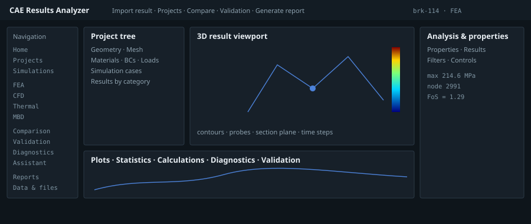

# CAE Results Analyzer

A solver-independent CAE post-processing and engineering analysis platform. Simulation results from
different solvers are mapped into one common result model, and every analysis — statistics, derived
calculations, validation, diagnostics, comparison, reporting — runs against that model rather than
against a particular solver's file format.

This is an **analysis and post-processing platform, not a CAE solver**. It does not compute
solutions; it reads results that a solver produced.



---

## What actually works today

| Area | State |
| --- | --- |
| Common CAE result model (nodes, surface mesh, fields, steps, load cases, units, materials, BCs, loads, convergence) | Implemented |
| Adapters: native `.json`, VTK legacy ASCII `.vtk`, point CSV `.csv` | Implemented, with tests |
| Adapters: ANSYS, Fluent, CFX, Abaqus, Nastran, LS-DYNA, OpenFOAM native, STAR-CCM+, COMSOL, Adams, CGNS | **Registered as planned** — no parser, calling one returns an explicit error |
| Statistics, extrema with node and coordinates, histogram, envelope, filtering | Implemented |
| Derived calculations (structural, fluid, thermal, MBD) with formula, inputs and assumptions | Implemented |
| Validation framework (8 checks, each with evidence) | Implemented |
| Diagnostics (7 rules, Finding → Severity → Evidence → Location → Cause → Investigation) | Implemented |
| Comparison A vs B (scalars, percentage change, pointwise field differences, overlays) | Implemented |
| Engineering assistant over structured application data | Implemented — retrieval and labelled blocks, **no language model** |
| Report generation (Markdown, HTML, JSON) | Implemented |
| Sample datasets for FEA, CFD, Thermal, MBD | Implemented, labelled as sample data |
| 3D result viewport (contours, probes, section plane, part visibility, time steps) | Implemented (three.js) |
| Optimization / DOE driver | **Not implemented** — the page says so and links to what does exist |
| Electromagnetic, battery, acoustics, manufacturing domains | Enumerated in the model, no domain-specific analysis yet |

Nothing in the interface claims support that the code does not have: adapter and domain status is
read from the backend registry, so the pages cannot drift from the implementation.

---

## Architecture

```text
              ┌──────────────────────── frontend (React + TypeScript + Vite) ────────────────────────┐
              │  Workspace: project tree │ 3D result viewport │ analysis & properties                │
              │                          └── plots / timeline / diagnostics dock ──┘                 │
              └───────────────────────────────────── fetch /api ───────────────────────────────────┘
                                                        │
              ┌───────────────────────────────── backend (FastAPI) ─────────────────────────────────┐
              │  api/        routes, request and response schemas                                   │
              │  services/   project & simulation store, assistant, report builder                  │
              │  analysis/   statistics · calculations · validation · diagnostics · comparison      │
              │  adapters/   native · VTK legacy · CSV · planned interfaces                         │
              │  core/       the common CAE result model and configuration                          │
              └─────────────────────────────────────────────────────────────────────────────────────┘

CAE file → adapter → parser → validation → common result model → analysis engines → API → UI
```

The import path is the same for every format, so adding a solver means writing one adapter class and
registering it; nothing downstream changes. See [docs/architecture](docs/architecture/README.md).

---

## Supported CAE domains

Implemented end to end with a sample dataset: **FEA/structural**, **CFD**, **Thermal**, **MBD**.
Enumerated in the model for future work: multiphysics, electromagnetic, battery/electro-thermal,
acoustics/NVH, manufacturing simulation, optimization/DOE.

---

## Installation

Requirements: Python 3.10+ and Node 18+ (Node 20 recommended).

```bash
git clone https://github.com/<your-account>/CAE-Results-Analyzer.git
cd CAE-Results-Analyzer

# 1. Backend
pip install -r backend/requirements-dev.txt
python scripts/generate_samples.py        # writes the four sample datasets into samples/

# 2. Frontend
cd frontend && npm install && cd ..
```

### Run the backend

```bash
cd backend
uvicorn app.main:app --reload --port 8000
# API root:      http://127.0.0.1:8000/api/health
# OpenAPI docs:  http://127.0.0.1:8000/docs
```

### Run the frontend

```bash
cd frontend
npm run dev            # http://localhost:5173, proxies /api to port 8000
```

Or start both with `./scripts/dev.sh`.

### Docker

```bash
docker compose up --build     # frontend on :8080, backend on :8000
```

### Desktop app

Runs the API and UI together as one native window instead of two terminals
and a browser tab:

```bash
cd frontend && npm install && npm run build && cd ..
pip install -r desktop/requirements.txt
python desktop/desktop_app.py
```

See [desktop/README.md](desktop/README.md) for platform requirements
(WebView2 on Windows, WKWebView on macOS, GTK/Qt on Linux) and how to build a
standalone executable with PyInstaller. Without a display or a supported
WebView backend, it falls back to opening your default browser.

---

## Testing

```bash
# backend — model, statistics, calculations, adapters, validation,
# diagnostics, comparison, assistant, reports, API
python -m pip install -r backend/requirements-dev.txt
python scripts/generate_samples.py
python -m pytest -c backend/pytest.ini backend/tests -q

# frontend — client and colour-map unit tests, type check, production build
(cd frontend && npm run typecheck && npm test && npm run build)
```

`tests/verify_install.sh` runs all of the above in one pass and is what CI executes.

---

## Node-ID-safe result comparison

Comparison computes **B minus A**, aligning B's result rows to A by explicit
Node ID before any pointwise subtraction. Reordering an otherwise identical
node table and its associated results returns exactly `0.0` difference.
Equal row counts alone never establish correspondence.

The Python `compare()` API raises `ComparisonValidationError` (a `ValueError`)
and the comparison/report HTTP endpoints return **422** for incompatible data:

- Node IDs must be explicitly supplied, unique integers, and present for every node.
- The complete ID sets must match. Missing/extra nodes are errors; there is no
  implicit intersection, interpolation, or scalar-only fallback.
- Unit-system declarations and compared field-unit strings must match exactly.
  Convert units explicitly before import; aliases are not silently normalised.
  Dimensionless fields need an explicit label such as `-` or `1`.
- Matching IDs must have matching finite **reference** coordinates (absolute
  tolerance `1e-9` in the declared length unit, zero relative tolerance).
  Meshes from changed geometry require an explicit mapping workflow, not ID reuse.
- Selected fields must be nodal, have matching field types and valid lengths,
  contain finite values, and have matching selected load-step/time values
  (absolute tolerance `1e-12`, zero relative tolerance).
- Vector-field comparisons retain the existing **difference of magnitudes**
  definition. They are not component-wise vector differences and cannot detect
  a pure direction change at constant magnitude.

Generated display indices are **not** solver Node IDs. CSV/VTK imports currently
without explicit identity support can still be viewed and analysed individually,
but cannot be pointwise-compared. Saving/reloading native JSON preserves this
restriction. Legacy files that previously saved generated row indices as IDs
must be re-imported with trustworthy source IDs; provenance cannot be recovered
from those old integers alone. The synthetic fixture generator explicitly owns
and assigns its reference-mesh IDs; its results remain labelled synthetic.

Run from the repository root (Python 3.10+):

```bash
python -m pip install -r backend/requirements-dev.txt
python scripts/generate_samples.py
python -m pytest -c backend/pytest.ini backend/tests/test_comparison_node_ids.py -q
python -m pytest -c backend/pytest.ini backend/tests -q
python -m uvicorn app.main:app --app-dir backend --port 8000
```

With the API running, this self-comparison must return zero differences:

```bash
curl -X POST http://127.0.0.1:8000/api/compare \
  -H 'Content-Type: application/json' \
  -d '{"simulation_a":"brk-114","simulation_b":"brk-114","fields":["von_mises"],"step":-1}'
```

Regression coverage includes reordered nonconsecutive IDs, known signed stress
changes, the original bracket-data reproduction, missing/duplicate IDs, unit
mismatch, incompatible geometry/steps, API/report errors and native roundtrips.
These are software verification checks, not validation of a physical design.

---

## Project structure

```text
CAE-Results-Analyzer/
├── backend/
│   ├── app/
│   │   ├── core/        result model, configuration
│   │   ├── adapters/    native, VTK legacy, CSV, planned interfaces
│   │   ├── analysis/    statistics, calculations, validation, diagnostics, comparison
│   │   ├── services/    store, assistant, report builder
│   │   ├── api/         routes and schemas
│   │   └── main.py      FastAPI application
│   └── tests/           pytest suite
├── frontend/
│   └── src/
│       ├── components/  viewport, legend, plot, finding card, primitives
│       ├── views/       home, projects, simulations, workspace, comparison, …
│       ├── lib/         API client, types, colour maps, formatting, hooks
│       └── styles/      application stylesheet
├── data/                runtime storage (projects, imported simulations) — git-ignored
├── samples/             sample datasets + external-format fixtures
├── scripts/             sample generator, mesh helpers, dev launcher
├── docs/                architecture, user guide, API, data model, development, validation
├── prototype/           the original single-file HTML prototype this project grew from
├── tests/               install verification script
└── docker-compose.yml
```

---

## Sample datasets

Generated by `scripts/generate_samples.py`, written to `samples/`, and flagged `is_sample_data` so
the interface and every report label them. The fields are analytic constructions shaped to resemble
the results they stand in for — they are **not** solver output and must not be used for engineering
decisions.

| Id | Dataset | Domain | Contents |
| --- | --- | --- | --- |
| `brk-114` | EV battery mounting bracket | FEA | von Mises, max principal, strain, deformation, contact pressure, strain energy; AA6061-T6 with yield strength; mesh refinement study; analytical reference |
| `aer-207` | EV aerodynamic body | CFD | pressure, Cp, velocity, wall shear, y+, temperature, vorticity; residual and Cd history; wind-tunnel reference value |
| `thm-088` | Battery cooling plate | Thermal | temperature (with a 55 °C limit that the result exceeds), heat flux, thermal gradient, HTC |
| `mbd-052` | Double-wishbone suspension | MBD | displacement, velocity, acceleration, joint force and torque over 21 time steps |

`samples/external/` holds a small VTK legacy file and a CSV probe export used by the adapter tests
and useful for trying the import page.

---

## Known limitations

- The sample datasets are synthetic. They exercise the software; they do not validate any design.
- Only surface (triangulated) meshes are carried. Volume elements are stored as metadata when an
  adapter reads them, but no volume rendering or element-based post-processing exists yet.
- Elemental fields are modelled but the bundled data and viewport are nodal.
- Pointwise comparison requires explicit Node IDs, identical ID sets and units, matching
  reference coordinates and compatible selected steps. Incompatible inputs raise validation
  errors; no mesh interpolation, automatic unit conversion or scalar-only fallback is implemented.
- The assistant is a retrieval layer over the application's own data. It has no language model, so
  it answers a fixed set of intents and says plainly when a question does not match one.
- Reports export to Markdown, HTML and JSON. There is no PDF writer.
- There is no authentication, multi-user separation or job queue; this is a single-user tool.

---

## Roadmap

1. Adapters with real parsers for VTU/VTM and Nastran OP2, then CGNS.
2. Volume mesh support and element-based fields end to end.
3. Mesh-to-mesh interpolation so results on different meshes can be differenced.
4. A pluggable language-model layer behind the existing assistant contract, keeping the block
   labelling and the evidence requirement.
5. An optimization/DOE driver that writes one simulation per design point and reads the scalars back
   through the comparison engine.
6. PDF export and report templates.

---

## Contributing

See [CONTRIBUTING.md](CONTRIBUTING.md). The short version: an adapter must have a real parser and a
test with a fixture file before its status changes from `planned` to `implemented`, and an analysis
result must carry the evidence it was derived from.

## License

MIT — see [LICENSE](LICENSE).
